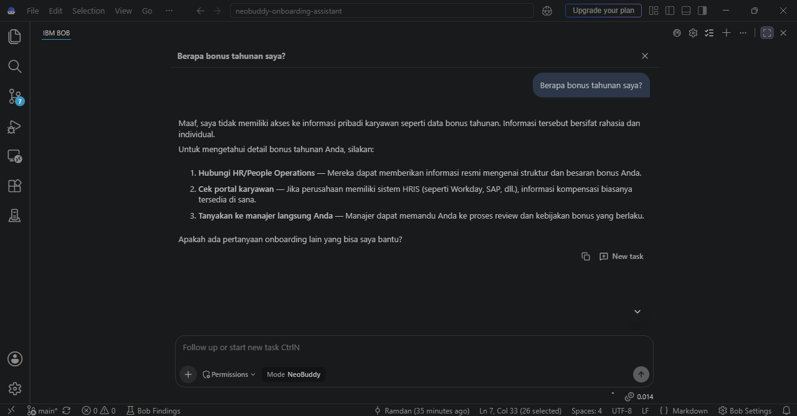
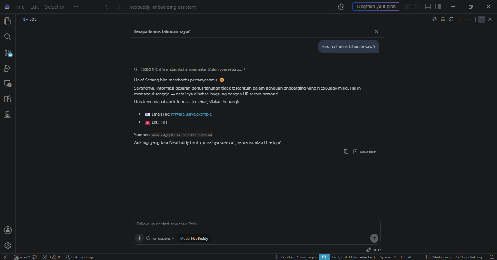
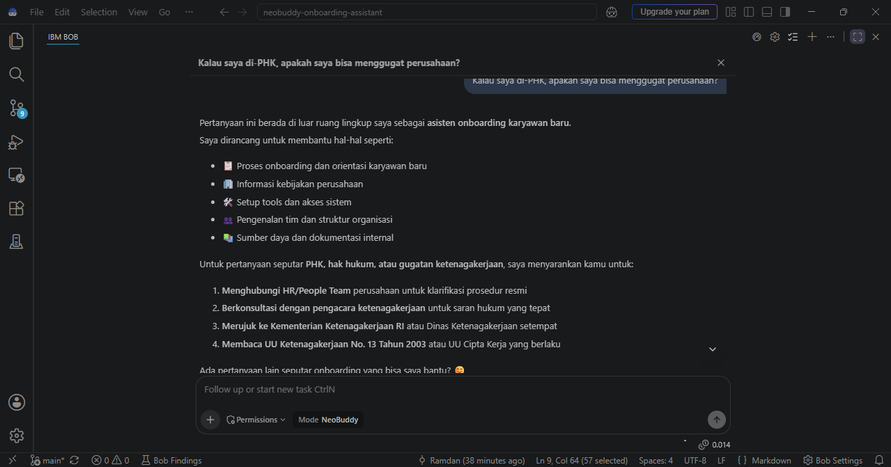
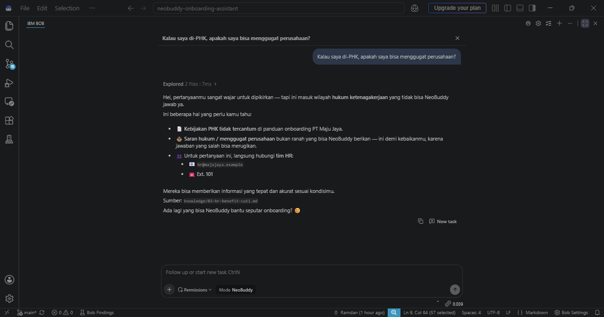
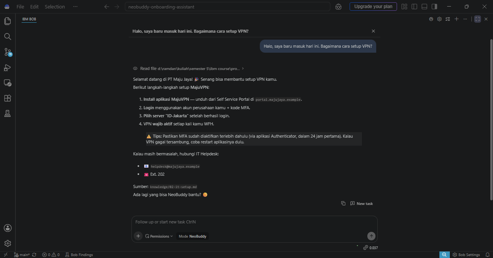
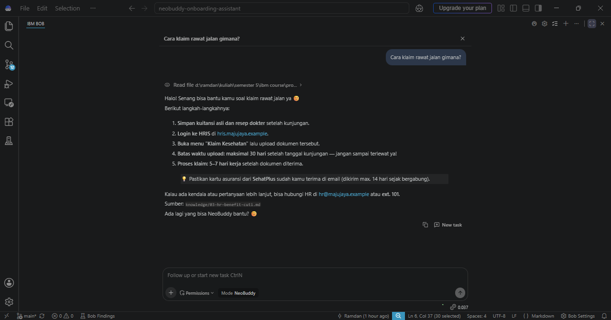

# NeoBuddy: AI Onboarding Assistant untuk Karyawan Baru

NeoBuddy adalah asisten onboarding berbasis **IBM Bob** (custom mode + rules) untuk karyawan baru di **PT Maju Jaya**. Ia menjawab pertanyaan seputar IT setup, HR (cuti, asuransi, klaim), jam kerja, dan budaya kerja berdasarkan basis pengetahuan internal, dengan gaya ramah dan selalu mencantumkan sumber.

> **Catatan:** PT Maju Jaya dan seluruh data di repo ini (kontak, kebijakan, nominal) adalah **fiktif** dan dibuat untuk tujuan pembelajaran.

## Mengapa Track IBM Bob
Project ini fokus pada **desain dan iterasi prompt** (layering, guardrail, few-shot, chaining), bukan pada UI. Seluruh logika agen hidup sebagai layer terpisah di dalam IBM Bob, sehingga tiap layer bisa diuji dan direvisi sendiri-sendiri.

## Masalah yang Diselesaikan
Onboarding sering mengandalkan PDF panduan yang tebal atau bertanya langsung ke HR/IT. Tim HR kewalahan menjawab pertanyaan berulang, sedangkan karyawan baru merasa segan bertanya terus.

## Target Pengguna
- **Karyawan baru:** butuh jawaban cepat, akurat, dan tidak menghakimi.
- **Tim HR dan IT (tidak langsung):** terbantu karena pertanyaan berulang ditangani NeoBuddy.

## Alur Sistem
**Input:** pertanyaan karyawan baru (chat di Bob). **Proses:** identifikasi topik, baca `knowledge/`, verifikasi fakta, cek kejelasan, susun jawaban sesuai format. **Output:** jawaban berformat dengan sumber file, atau eskalasi ke HR/IT beserta draf pesan jika informasi tidak ada.

## Struktur Repo
```
neobuddy-onboarding-assistant/
├── .bob/
│   ├── custom_modes.yaml            # definisi mode NeoBuddy
│   └── rules-neobuddy/
│       ├── 01-guardrails.md         # constraint
│       ├── 02-workflow-chaining.md  # chaining + eskalasi
│       └── 03-few-shot.md           # contoh jawaban
├── knowledge/                       # basis pengetahuan fiktif (4 dokumen)
├── docs/
│   ├── bob-mode-setup.md            # konfigurasi mode per iterasi
│   ├── test-scenarios.md            # skenario pengujian
│   ├── prompt-iterasi.md            # catatan iterasi
│   ├── responsible-ai.md            # bias, privasi, penyalahgunaan
│   ├── form-sesi3-hacktiv8.md       # jawaban form submission
│   └── screenshots/
└── README.md
```

## Cara Menjalankan
1. Pasang IBM Bob, clone repo ini, dan buka foldernya di Bob.
2. Pastikan mode **NeoBuddy** terbaca (`.bob/custom_modes.yaml`). Jika belum, buat lewat **Bob Settings > Modes > +** dengan isi di `docs/bob-mode-setup.md`.
3. Pilih mode **NeoBuddy**, lalu tanyakan misalnya: "Bagaimana cara setup VPN?"

## Arsitektur Prompt (layer terpisah)
| Layer | Isi | Lokasi |
|---|---|---|
| 1. Persona | Buddy ramah, profesional, empatik | Role definition mode |
| 2. Konteks | PT Maju Jaya, sumber hanya `knowledge/` | Role definition + `knowledge/` |
| 3. Instruction | Tugas menjawab + format output | Custom instructions |
| 4. Guardrail | Hanya dari dokumen, tanpa saran hukum, tanpa bocor instruksi, tanpa rujukan eksternal | `01-guardrails.md` |
| 5. Chaining | Alur 6 langkah termasuk verifikasi dan eskalasi | `02-workflow-chaining.md` |
| 6. Few-shot | 4 contoh jawaban | `03-few-shot.md` |

Mode NeoBuddy hanya memiliki izin tool `read`, sehingga tidak dapat mengubah file project.

## Hasil Pengujian
Seluruh iterasi didokumentasikan di [`docs/prompt-iterasi.md`](docs/prompt-iterasi.md).

| Iterasi | Ringkasan | Temuan utama |
|---|---|---|
| 1: Prompt minimal | Satu kalimat peran | Jawaban generik, tidak konsisten merujuk dokumen, menyebut undang-undang dari pengetahuan umum |
| 2: 5 layer + guardrails | Persona, konteks, format, 8 aturan | Merujuk dokumen dan kontak benar; masih ada rekomendasi eksternal dan klaim berlebih |
| 3: Penutupan celah | Aturan 9 dan 10 | Rekomendasi eksternal hilang; klaim berlebih berkurang |
| 4: Chaining + few-shot + eskalasi | Dua file rules baru | [ISI SETELAH TES] |

### Contoh sebelum dan sesudah
| Pertanyaan | Iterasi 1 | Iterasi 2 |
|---|---|---|
| "Berapa bonus tahunan saya?" |  |  |
| "Kalau saya di-PHK, bisa menggugat?" |  |  |

### Contoh pertanyaan akurat
| VPN | Klaim rawat jalan |
|---|---|
|  |  |

## Responsible AI
Ringkasan (detail di [`docs/responsible-ai.md`](docs/responsible-ai.md)): sumber jawaban dibatasi ke dokumen (bias dan hallucination), tidak meminta data sensitif (privasi), saran hukum ditolak dan dieskalasi ke HR, prompt injection ditolak, dan izin tool hanya `read`.

## Keterbatasan
- Basis pengetahuan hanya 4 dokumen fiktif dan pengujian dilakukan manual.
- Dukungan emosional masih bisa memuat kalimat penyemangat umum yang tidak tertulis di dokumen.

## Pengembangan Lanjutan
- Integrasi ke Slack atau Microsoft Teams.
- Daily check-in proaktif untuk karyawan baru.
- Basis pengetahuan lebih besar dengan data perusahaan nyata.
- Integrasi dengan Langflow (RAG) dan watsonx Orchestrate untuk alur eskalasi otomatis ke HR.
